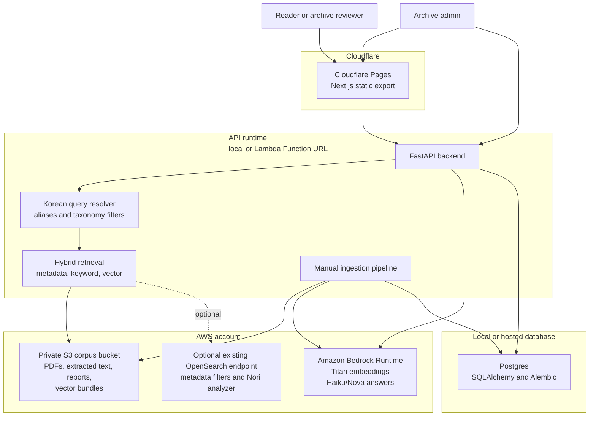
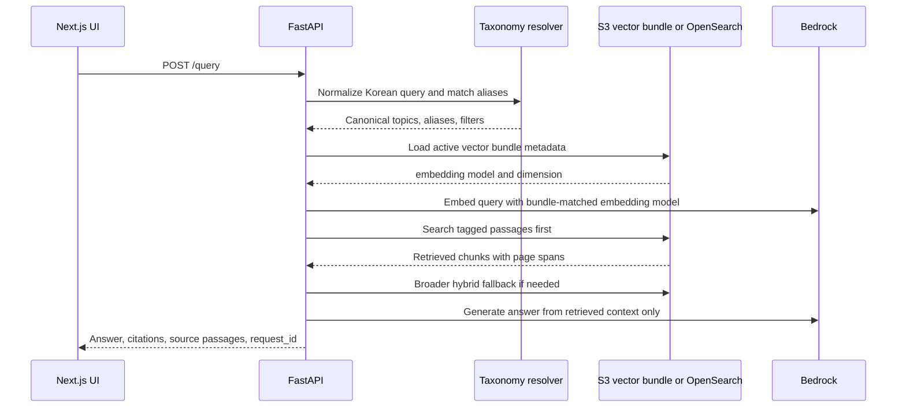
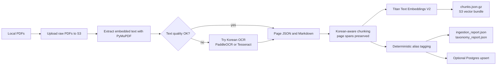

# Architecture

Health1004 is a taxonomy-first Korean PDF archive with an optional assistant layer. The default architecture favors low operating cost: static frontend, private S3 corpus storage, manual ingestion, Bedrock calls only when needed, and an S3-hosted vector bundle instead of an always-on search cluster.

## Container View

## Runtime Query Flow

The answer path is grounded by design. If retrieval returns weak or empty context, the API should not ask the model to invent an answer.

## Bedrock Model Boundary

The default model profile is documented in [model-strategy.md](model-strategy.md):

- primary answer model: `anthropic.claude-haiku-4-5-20251001-v1:0`
- fallback answer model: `amazon.nova-2-lite-v1:0`
- embedding model: `amazon.titan-embed-text-v2:0`
- reranking disabled by default

Answer models can be changed independently of the vector bundle. Embedding model changes require rebuilding vectors because stored passage vectors and query vectors must share the same embedding model and dimension.

## Ingestion Flow

The corpus is manually ingested. There are no crawlers, recurring jobs, or scheduled data pulls.

## Data Model

The structured schema lives in `backend/app/db_models.py` and is migrated by Alembic. It includes:

- `documents`, `articles`, `pages`, `passages`
- `topics`, `topic_aliases`, `body_systems`
- `foods`, `conditions`, `symptoms`, `substances`, `habits`
- `passage_topic_assignments`, `retrieval_logs`

Each passage keeps citation and review metadata such as `document_id`, `article_id`, `page_start`, `page_end`, `section_heading`, `original_korean_text`, category tags, `topic_slugs`, `confidence_score`, `needs_human_review`, source S3 keys, `embedding_id`, and `chunk_id`.

## Source Traceability

Chunks and citations are page-aware. Returned citations include, where available:

- PDF filename
- document title
- detected date
- page start and end
- section heading
- original Korean quote
- document and chunk identifiers
- signed PDF URL

## OpenSearch Boundary

OpenSearch is optional. The default Terraform does not provision it because this is a low-volume archive. `scripts/reindex_with_taxonomy.py` can write local mapping and reindex plans without a live endpoint, or target an existing endpoint when `OPENSEARCH_ENDPOINT` is configured.

When Nori is available, mappings use a Korean analyzer. When it is not available, the mapping falls back to standard analysis plus keyword fields and alias expansion.

## Deployment Boundary

Cloudflare Pages hosts the static frontend. The backend is intentionally decoupled and can run locally or on a Lambda Function URL. Terraform creates private S3 storage and IAM policies by default, and can add the Lambda API when `deploy_api=true`; it does not create an always-on API host.
