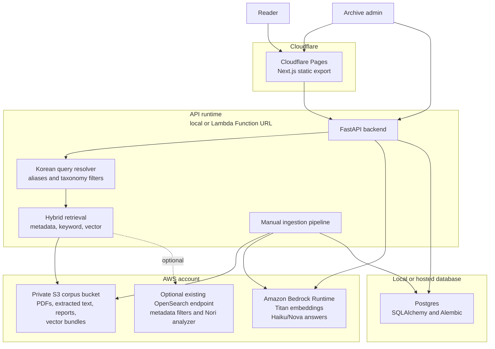
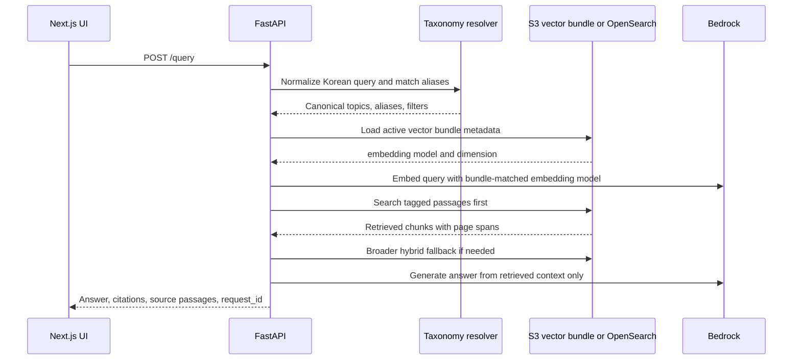
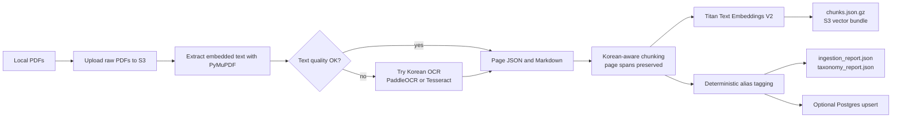
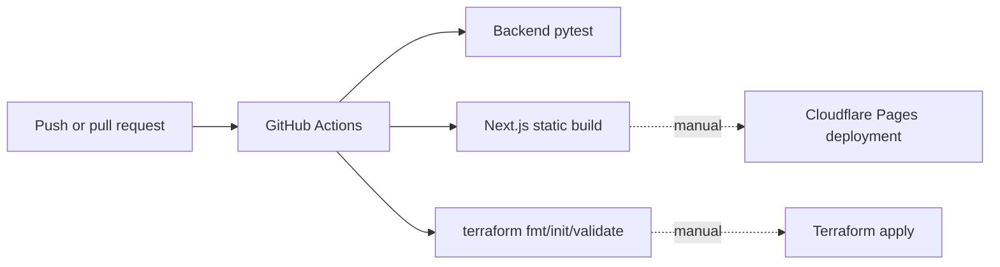

# Architecture

Health1004 is a taxonomy-first Korean PDF archive with an optional assistant layer. The default architecture favors low operating cost: static frontend, private S3 corpus storage, manual ingestion, Bedrock calls only when needed, and an S3-hosted vector bundle instead of an always-on search cluster.

## Container View

## Runtime Query Flow

The answer path is grounded by design. If retrieval returns weak or empty context, the API should not ask the model to invent an answer.

## Bedrock Model Boundary

The default model profile is documented in [model-strategy.md](model-strategy.md):

- primary answer model: `anthropic.claude-haiku-4-5-20251001-v1:0`
- fallback answer model: `amazon.nova-2-lite-v1:0`
- embedding model: `amazon.titan-embed-text-v2:0`
- reranking disabled by default

Answer models can be changed independently of the vector bundle. Embedding model changes require rebuilding vectors because stored passage vectors and query vectors must share the same embedding model and dimension.

## Ingestion Flow

The corpus is manually ingested. There are no crawlers, recurring jobs, or scheduled data pulls.

## Data Model

The structured schema lives in `backend/app/db_models.py` and is migrated by Alembic. It includes:

- `documents`, `articles`, `pages`, `passages`
- `topics`, `topic_aliases`, `body_systems`
- `foods`, `conditions`, `symptoms`, `substances`, `habits`
- `passage_topic_assignments`, `retrieval_logs`

Each passage keeps citation and review metadata such as `document_id`, `article_id`, `page_start`, `page_end`, `section_heading`, `original_korean_text`, category tags, `topic_slugs`, `confidence_score`, `needs_human_review`, source S3 keys, `embedding_id`, and `chunk_id`.

## Source Traceability

Chunks and citations are page-aware. Returned citations include, where available:

- PDF filename
- document title
- detected date
- page start and end
- section heading
- original Korean quote
- document and chunk identifiers
- signed PDF URL

## OpenSearch Boundary

OpenSearch is optional. The default Terraform does not provision it because this is a low-volume archive. `scripts/reindex_with_taxonomy.py` can write local mapping and reindex plans without a live endpoint, or target an existing endpoint when `OPENSEARCH_ENDPOINT` is configured.

When Nori is available, mappings use a Korean analyzer. When it is not available, the mapping falls back to standard analysis plus keyword fields and alias expansion.

## Deployment Boundary

Cloudflare Pages hosts the static frontend. The backend is intentionally decoupled and can run locally or on a Lambda Function URL. Terraform creates private S3 storage and IAM policies by default, and can add the Lambda API when `deploy_api=true`; it does not create an always-on API host.

## Key AWS And Service Boundaries

| Boundary | Responsibility | Notes |
| --- | --- | --- |
| Cloudflare Pages | Public static archive UI | Hosts exported Next.js routes and static archive JSON. It does not hold AWS secrets. |
| FastAPI runtime | Archive APIs, query resolution, RAG, admin actions | Runs locally by default or as an optional Lambda Function URL. |
| Private S3 bucket | Durable corpus artifacts | Stores raw PDFs, extracted text, manifests, reports, and vector bundles. Public access is blocked. |
| Bedrock Runtime | Embeddings and answer generation | Invoked only by ingestion/query code with configured model ids. |
| Postgres | Structured taxonomy and review state | Local Docker Compose by default; hosted database is optional. |
| OpenSearch | Optional search/index expansion | Supported by scripts and mappings, not provisioned by Terraform. |

## Data Flow

1. An operator places source PDFs in `./pdfs` or uploads through the admin flow.
2. Ingestion uploads raw PDFs to private S3 and writes extracted page JSON/Markdown.
3. Chunks keep document ids, filenames, page spans, section headings, original Korean text, and S3 keys.
4. Titan embeddings are written into a compressed S3 vector bundle with embedding metadata.
5. Taxonomy tagging enriches chunks with canonical topic/category slugs and review confidence.
6. Static archive JSON is generated for Cloudflare Pages browsing.
7. Query-time retrieval loads the active bundle, embeds the question with the bundle-matched model, searches tagged passages, and returns citations.

## Auth And Authorization Flow

Reader browse paths are public when deployed to Cloudflare Pages. API-backed query paths rely on the configured backend endpoint and do not require user login in the current implementation.

Admin operations are intentionally simple for a low-volume internal workflow:

- `/admin/ingest` requires `ADMIN_TOKEN` through `X-Admin-Token` or Bearer auth.
- Review and alias-suggestion paths require `ADMIN_PASSWORD`, with a local-only fallback when no password is configured.
- Terraform separates ingestion and runtime IAM policies so the principal that runs ingestion does not need broad account access.

For a private or multi-user deployment, the next step would be replacing shared secrets with an identity provider, role-based authorization, audit events, and secret rotation.

## CI/CD Flow

The repository has a CI contract but no automatic production deployment in GitHub Actions. Cloudflare Pages and Terraform applies are operator-controlled.

## Key Constraints

- The public live site is static unless a backend API URL is configured at build/deploy time.
- The default Terraform does not provision OpenSearch, App Runner, ECR, CloudFront, or scheduled ingestion.
- Lambda Function URL auth is `NONE`; application-level admin controls protect admin endpoints, and reader-facing query endpoints are public if the function URL is public.
- Embedding model changes require a full vector rebuild because stored passage vectors and query vectors must share the same model and dimension.
- Health-adjacent user questions can be sensitive even when the app is educational; query persistence and log retention need an explicit production policy.
- OCR and taxonomy quality remain human-review responsibilities, not solved infrastructure problems.
